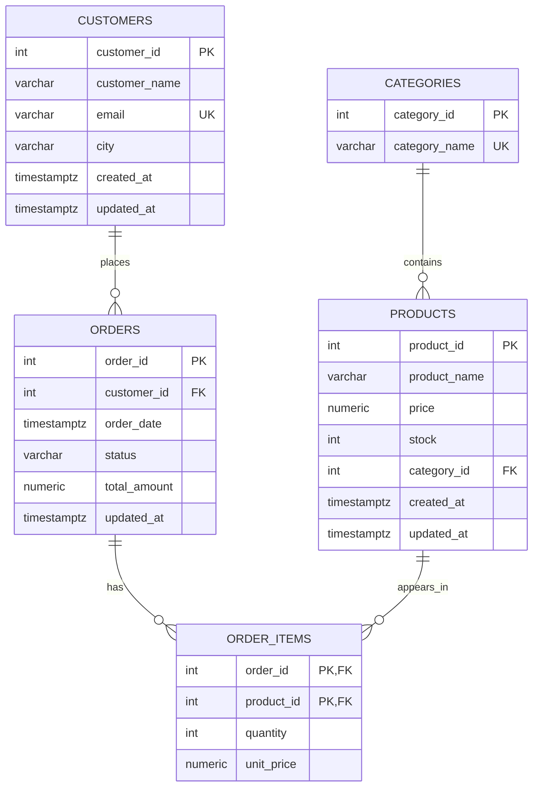

# E-commerce Data Engineering Project

## 1. Objective
Build an end-to-end data pipeline from PostgreSQL OLTP
to a Data Warehouse for sales analytics.

## 2. OLTP Tables
- customers
- categories
- products
- orders
- order_items

## 3. Relationships
- customers 1:N orders
- categories 1:N products
- orders 1:N order_items
- products 1:N order_items

## 4. Business Rules
- Unique customer email
- Price > 0
- Quantity > 0
- Stock >= 0
- Order status: PENDING, PAID, SHIPPED, CANCELLED
- Composite PK: (order_id, product_id)

## 5. Dataset Targets
- 200 customers
- 8 categories
- 60 products
- 1000 orders
- 2500 order items

## 6. Data Warehouse
Star Schema:
- fact_sales
- dim_customer
- dim_product
- dim_date

Grain: one row per order item.

## 7. OLTP Tables — Detailed Design

### 7.1 customers

| Column | Data Type | Constraints |
|---|---|---|
| customer_id | INTEGER | PRIMARY KEY, IDENTITY |
| customer_name | VARCHAR(100) | NOT NULL |
| email | VARCHAR(150) | NOT NULL, UNIQUE |
| city | VARCHAR(100) | NOT NULL |
| created_at | TIMESTAMPTZ | NOT NULL, DEFAULT CURRENT_TIMESTAMP |
| updated_at | TIMESTAMPTZ | NOT NULL, DEFAULT CURRENT_TIMESTAMP |

### 7.2 categories

| Column | Data Type | Constraints |
|---|---|---|
| category_id | INTEGER | PRIMARY KEY, IDENTITY |
| category_name | VARCHAR(100) | NOT NULL, UNIQUE |

### 7.3 products

| Column | Data Type | Constraints |
|---|---|---|
| product_id | INTEGER | PRIMARY KEY, IDENTITY |
| product_name | VARCHAR(150) | NOT NULL |
| price | NUMERIC(12,2) | NOT NULL, CHECK (price > 0) |
| stock | INTEGER | NOT NULL, CHECK (stock >= 0) |
| category_id | INTEGER | NOT NULL, FK → categories |
| created_at | TIMESTAMPTZ | NOT NULL, DEFAULT CURRENT_TIMESTAMP |
| updated_at | TIMESTAMPTZ | NOT NULL, DEFAULT CURRENT_TIMESTAMP |

### 7.4 orders

| Column | Data Type | Constraints |
|---|---|---|
| order_id | INTEGER | PRIMARY KEY, IDENTITY |
| customer_id | INTEGER | NOT NULL, FK → customers |
| order_date | TIMESTAMPTZ | NOT NULL |
| status | VARCHAR(20) | NOT NULL, CHECK |
| total_amount | NUMERIC(14,2) | NOT NULL, CHECK (total_amount >= 0) |
| updated_at | TIMESTAMPTZ | NOT NULL, DEFAULT CURRENT_TIMESTAMP |

Allowed statuses: PENDING, PAID, SHIPPED, CANCELLED.

### 7.5 order_items

| Column | Data Type | Constraints |
|---|---|---|
| order_id | INTEGER | FK → orders |
| product_id | INTEGER | FK → products |
| quantity | INTEGER | NOT NULL, CHECK (quantity > 0) |
| unit_price | NUMERIC(12,2) | NOT NULL, CHECK (unit_price > 0) |

Composite Primary Key: (order_id, product_id).

### 7.6 Additional Business Rules

- A customer can place multiple orders.
- An order belongs to one customer.
- An order can contain multiple products.
- A product can appear in multiple orders.
- Each product belongs to one category.
- The same product cannot appear twice in the same order.
- `products.price` represents the current catalog price.
- `order_items.unit_price` represents the actual purchase price.
- `orders.total_amount` should equal the sum of its order items.
- `updated_at` will support incremental data extraction and SCD Type 2 processing.

## 8. ERD Diagram

## 9. Data Warehouse Design

### Architecture
Source: PostgreSQL public schema (OLTP)
Target: PostgreSQL analytics schema (Data Warehouse)

### Modeling Approach
Star Schema

### Fact Table
fact_sales

Grain: One row per order item.

Primary Key: (order_id, product_id)

Foreign Keys:
- customer_key -> dim_customer
- product_key -> dim_product
- date_key -> dim_date

Measures:
- quantity
- unit_price
- revenue = quantity * unit_price

Additional attribute:
- order_status

### Dimensions
dim_customer:
- customer_key (Surrogate PK)
- customer_id (Business Key)
- customer_name
- city
- valid_from
- valid_to
- is_current

dim_product:
- product_key (Surrogate PK)
- product_id (Business Key)
- product_name
- category_name
- valid_from
- valid_to
- is_current

dim_date:
- date_key (PK)
- full_date
- day_number
- month_number
- month_name
- quarter_number
- year_number

### History Management
SCD Type 2 for Customer and Product dimensions.

### Initial Load Target
2500 fact_sales rows from 2500 order_items.

