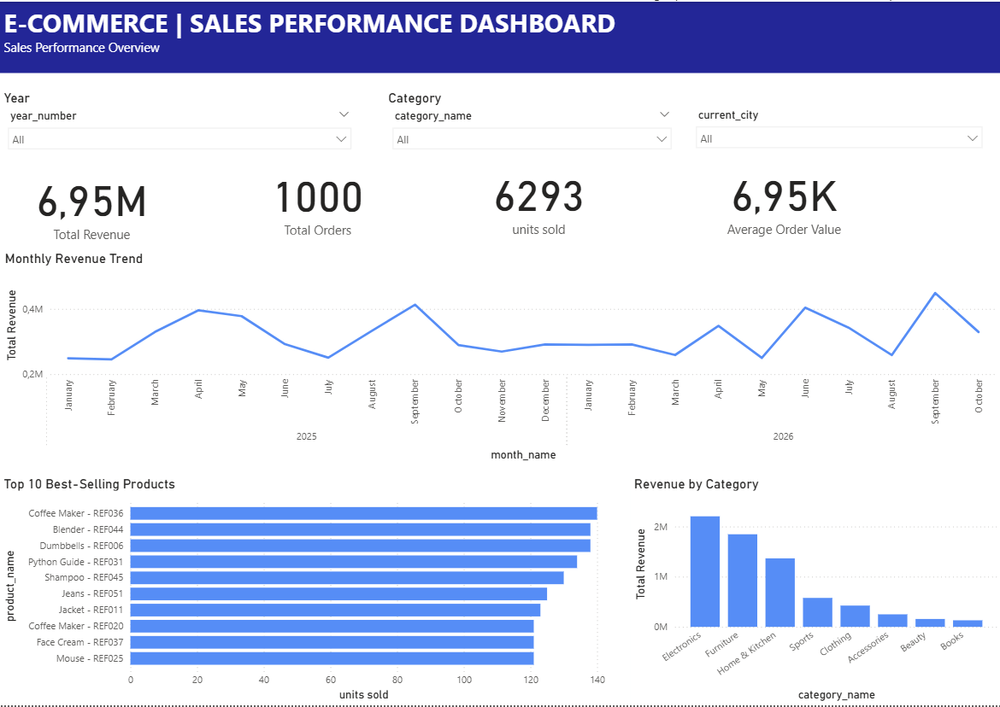

# E-commerce Data Engineering Pipeline

## Project Overview

An end-to-end Data Engineering project that transforms
E-commerce transactional data into an analytical
Data Warehouse and an interactive Power BI dashboard.

## Technologies

- PostgreSQL — OLTP Database & Data Warehouse
- Python — ETL and Incremental Data Processing
- SQL — Data Modeling and Analytics
- Power BI — Business Intelligence Dashboard
- Git & GitHub — Version Control

## Data Pipeline Architecture

1. E-commerce OLTP Database (PostgreSQL)
2. Python ETL Pipeline (Full Load & Incremental)
3. Data Quality & Transformations
4. Data Warehouse (Star Schema)
5. SCD Type 2 for Customers and Products
6. SQL Analytics
7. Power BI Dashboard

## Key Features

- Synthetic E-commerce Data Generation
- Full and Incremental ETL
- Watermark-based Change Tracking
- Slowly Changing Dimensions (SCD Type 2)
- Data Quality Validation
- Transaction Management (COMMIT / ROLLBACK)
- ETL Logging and Error Handling
- Interactive Sales Performance Dashboard


## Installation & Execution

### 1. Requirements

- Python 3
- PostgreSQL
- Python dependencies
- Power BI Desktop (for dashboard visualization)

### 2. Database Setup

Create a PostgreSQL database named:

`ecommerce_pipeline_db`

The project uses two schemas:
- `public`: E-commerce transactional data (OLTP)
- `analytics`: Data Warehouse (Star Schema)

### 3. Python Environment

Create a virtual environment:

```powershell
python -m venv .venv
```

Activate it on Windows:

```powershell
.\.venv\Scripts\Activate.ps1
```

Install the dependencies listed in `requirements.txt`
once that file has been generated.

### 4. Run the ETL Pipeline

First, prepare the PostgreSQL tables and load
the source data.

Run the Full ETL for the initial DW load:

```powershell
python src/etl_pipeline.py
```

Run Incremental ETL for subsequent changes:

```powershell
python src/incremental_etl.py
```

### 5. Monitoring

The incremental pipeline provides:
- Execution summaries
- Watermark tracking
- Transaction rollback on failure
- Success and error logs

Log file:

`logs/incremental_etl.log`


## Data Model Documentation

### 1. OLTP Database

The transactional database uses the `public` schema
and contains five main tables:

| Table | Description |
|---|---|
| customers | Customer information |
| categories | Product categories |
| products | Product information, prices and stock |
| orders | Customer orders, dates and statuses |
| order_items | Products, quantities and prices per order |

Primary Keys (PK), Foreign Keys (FK), constraints,
and indexes ensure data integrity.

The `updated_at` columns and PostgreSQL triggers
support incremental change detection.

### 2. Data Warehouse — Star Schema

The analytical database uses the `analytics` schema.

**Fact Table:**
- fact_sales: sales transactions at order-item level.

**Dimension Tables:**
- dim_customer: customer attributes and history.
- dim_product: product attributes and history.
- dim_date: calendar information.

### 3. Fact Table Grain

One row in `fact_sales` represents one product
line within an order.

The composite primary key is:

`(order_id, product_id)`

Main measures:
- quantity
- unit_price
- revenue = quantity * unit_price

### 4. Star Schema Relationships

fact_sales.customer_key → dim_customer.customer_key

fact_sales.product_key → dim_product.product_key

fact_sales.date_key → dim_date.date_key

Each dimension has a one-to-many relationship
with the fact table.

### 5. Slowly Changing Dimensions — SCD Type 2

Customer and Product dimensions implement SCD Type 2.

Historical versions are maintained using:
- valid_from
- valid_to
- is_current

When a tracked attribute changes:

1. The previous version is closed.
2. A new version is inserted.
3. The new version receives a surrogate key.
4. Historical sales preserve their original
   dimension relationships.

This allows accurate historical reporting
while retaining current customer and product data.


## Power BI Dashboard

The interactive Power BI dashboard provides an overview
of E-commerce sales performance.

### Main KPIs
- Total Revenue
- Total Orders
- Units Sold
- Average Order Value (AOV)

### Visualizations
- Monthly Revenue Trend
- Top 10 Best-Selling Products
- Revenue by Category

### Interactive Filters
- Year
- Current Customer City
- Current Product Category

### Dashboard Preview



The dashboard is available in:
`dashboards/Ecommerce_Sales_Dashboard.pbix`
